<div align="center">

# 📦 Demand Forecasting & Inventory Policy

**Forecast demand. Quantify uncertainty. Make inventory decisions you can defend.**


[✨ Why](#-why-this-project) · [📜 Golden Rules](#-golden-rules) · [🔄 Pipeline](#-how-it-works) · [🚀 Quick Start](#-quick-start) · [🧠 Models](#-modelling-approach) · [🛒 Inventory](#-inventory-policy) · [📊 Metrics](#-evaluation-metrics) · [🤝 Contributing](#-contributing)

</div>

---

## ✨ Why This Project

Stock-outs lose sales and customers. Overstock ties up cash, fills warehouses and leads to markdowns and write-offs. Most teams start by ordering from experience or a spreadsheet moving average, which works until demand becomes **seasonal, promotional, or spread across hundreds of SKUs and several locations**.

This project replaces guesswork with a **repeatable pipeline** that forecasts demand and turns the forecast into concrete inventory decisions.

| 🎯 You get | 💡 How |
|---|---|
| Honest accuracy | Time-based backtesting, no leakage |
| Decisions, not just numbers | Safety stock, reorder point and order quantity from forecast uncertainty |
| Full traceability | Every run records data version, model and parameters |
| Safe human input | Logged, owned and reviewable overrides |

---

## 📜 Golden Rules

> These are non-negotiable. Every contribution and every forecast run is held to them.

| # | Rule | Enforced by |
|:-:|---|---|
| 1 | Forecasts **MUST** come from versioned, validated datasets in `data/processed/`. Raw files in `data/raw/` **MUST** never be edited. | Ingestion |
| 2 | Every model **MUST** be backtested with time-based (rolling-origin) validation. Random splits **MUST NOT** be used. | Evaluation |
| 3 | Every model **MUST** be compared against a naive baseline (seasonal naive or moving average) and promoted only if it beats it. | Evaluation |
| 4 | Accuracy **MUST** be reported with **WAPE, bias and MASE** at SKU/location level, not only as one global number. | Evaluation |
| 5 | Model, data version and parameters of each run **MUST** be recorded in `reports/runs/`. | Reporting |
| 6 | Inventory recommendations **MUST** use the forecast *and* its uncertainty, not the point forecast alone. | Inventory |
| 7 | Manual overrides **MUST** be logged in `config/overrides.csv` with a reason and an owner. | Governance |
| 8 | Dependencies **MUST** be pinned in `requirements.txt`. | Environment |
| 9 | Any change to forecasting or inventory logic **MUST** include tests in `tests/`. | CI |

<details>
<summary><b>🧐 Why these rules exist (click to expand)</b></summary>

<br>

**🕳️ Data leakage**
Demand is a time series. If future information leaks into training (random splits, features computed over the full history), accuracy looks excellent in testing and collapses in production. Time-based backtesting is the only honest estimate of how a model will behave next month.

**🎭 Misleading accuracy**
A single average error hides the fact that high-volume SKUs can be forecast well while slow movers and new products are not. Metrics are reported per SKU/location and per demand class (smooth, intermittent, lumpy). Bias is tracked separately because a consistently over-forecasting model quietly inflates inventory.

**🎲 Point forecasts are not decisions**
Safety stock exists because forecasts are wrong. The same average forecast needs very different buffers for a stable product and a volatile one, and for a 2-day versus a 30-day lead time. Inventory policy is computed from the forecast distribution and lead-time variability.

**🔍 Reproducibility**
When a planner asks why last month's order was so large, the answer must be traceable to a data version, a model and a set of parameters. Run metadata and logged overrides make forecasts auditable.

</details>

---

## 🔄 How It Works

```mermaid
flowchart LR
    A[📥 data/raw<br/>sales · stock · POs] --> B[✅ Ingestion<br/>validate + flag stock-outs]
    B --> C[🗂️ data/processed<br/>versioned datasets]
    C --> D[🧩 Features<br/>calendar · price · promo · lags]
    D --> E[🧠 Models<br/>baseline · statistical · ML]
    E --> F[🧪 Rolling-origin<br/>backtest]
    F -->|beats baseline| G[🔮 Forecast<br/>+ uncertainty]
    F -->|does not beat| E
    G --> H[✍️ Overrides<br/>config/overrides.csv]
    H --> I[🛒 Inventory<br/>SS · ROP · order qty]
    I --> J[📊 reports/runs/&lt;run_id&gt;]
```



---

## 🗂️ Project Structure

<details>
<summary><b>Click to explore the layout</b></summary>

```text
.
├── config/              # Parameters, service levels, overrides
├── data/
│   ├── raw/             # Untouched source extracts (sales, stock, POs)
│   └── processed/       # Cleaned, validated, versioned datasets
├── notebooks/           # Exploration only; no production logic
├── src/
│   ├── ingestion/       # Loading and validation
│   ├── features/        # Calendar, price, promo, lag features
│   ├── models/          # Baselines, statistical and ML models
│   ├── evaluation/      # Backtesting and metrics
│   └── inventory/       # Safety stock, reorder point, EOQ
├── reports/
│   └── runs/            # Per-run metadata, metrics, forecasts
├── tests/
└── requirements.txt
```

</details>

---

## 🧾 Data Requirements

One row per **SKU × location × period** (daily or weekly).

| Column | Required | Description |
|---|:-:|---|
| `date` | ✅ | Period start date |
| `sku` | ✅ | Product identifier |
| `location` | ✅ | Store or warehouse identifier |
| `units_sold` | ✅ | Units demanded (see stock-out note below) |
| `on_hand` | ✅ | Closing inventory for the period |
| `price` | ➕ | Selling price (optional, recommended) |
| `promo_flag` | ➕ | `1` if on promotion (optional) |
| `lead_time_days` | ✅ | Supplier lead time (for inventory policy) |

> [!NOTE]
> **Sales are not demand.** On days a product is out of stock, sales understate demand. Stock-out periods are flagged during ingestion and treated as **censored data**, not as true zero demand.

---

## 🚀 Quick Start

**1️⃣ Set up the environment**

```bash
python -m venv .venv
source .venv/bin/activate
pip install -r requirements.txt
```

**2️⃣ Drop extracts into `data/raw/` and validate**

```bash
python -m src.ingestion.validate --input data/raw/
```

**3️⃣ Build features and run a backtest**

```bash
python -m src.evaluation.backtest --config config/backtest.yaml
```

**4️⃣ Generate forecasts and inventory recommendations**

```bash
python -m src.models.forecast --horizon 12 --config config/forecast.yaml
python -m src.inventory.recommend --config config/service_levels.yaml
```

📁 Outputs land in `reports/runs/<run_id>/`.

---

## 🧠 Modelling Approach

Models are chosen **per demand pattern, from simple to complex**.

| Tier | Models | Best for |
|---|---|---|
| 🟢 **Baselines** | Naive, seasonal naive, moving average | The bar every model must clear |
| 🔵 **Statistical** | ETS, ARIMA/SARIMA | Trend and seasonality on stable series |
| 🟣 **Intermittent** | Croston, SBA | Slow movers with many zero periods |
| 🔴 **Machine learning** | LightGBM / XGBoost with lag, rolling, calendar, price and promo features, trained globally across SKUs | Large catalogs with promotions and shared patterns |

> A more complex model is adopted **only** when it beats the simpler one in backtesting on the metrics that matter for the business.

---

## 🛒 Inventory Policy

For each SKU/location, the pipeline computes:

| Output | Formula / Method |
|---|---|
| 🛡️ **Safety stock** | `z × σ_LT`, where `z` comes from the target service level and `σ_LT` is the forecast error over the lead time (including lead-time variability) |
| 🔔 **Reorder point** | Expected demand during lead time + safety stock |
| 📦 **Order quantity** | EOQ or min/max rules, adjusted for MOQ and pack size |
| 🚨 **Alerts** | Projected stock-outs, excess stock, slow-moving items |

🎚️ Target service levels live in `config/service_levels.yaml`.

---

## 📊 Evaluation Metrics

| Metric | What it tells you | Read it as |
|---|---|---|
| **WAPE** | Primary accuracy measure, robust to small and zero values | Lower is better |
| **Bias** | Signed error | Positive means over-forecasting |
| **MASE** | Error scaled against the naive baseline | Below 1 means the model beats the baseline |
| **Service level / fill rate** | Business outcome, simulated on historical demand | Higher is better |
| **Inventory turns** | Business outcome, simulated on historical demand | Higher is better |

---

## ✍️ Managing Forecast Overrides

Planners sometimes know things the data does not: a new contract, a supplier issue, a planned campaign.

1. **Log it.** Add a row to `config/overrides.csv` with SKU, location, period, adjustment (absolute or percentage), reason and owner.
2. **Re-run.** Re-run the forecast step. Overrides are applied after the model and labelled in the output.
3. **Review.** After the period closes, check whether the override improved accuracy. Overrides that consistently hurt should be revisited.

---

## 🔁 Retraining & Monitoring

Models are retrained on a schedule (weekly or monthly) or when monitoring detects drift.

<details>
<summary><b>🚦 Review triggers (click to expand)</b></summary>

<br>

- [ ] WAPE rises materially above its backtest level for several periods
- [ ] Bias drifts consistently in one direction
- [ ] New products, price changes or promotions fall outside the training history

**Then:** re-run the backtest on recent data, compare against the current production model and the baseline, and promote the new model **only if it wins**.

</details>

---

## 🤝 Contributing

- [ ] Keep production logic in `src/`; notebooks are for exploration only
- [ ] Add or update tests for any change to features, models or inventory formulas
- [ ] Document any new assumption in this README
- [ ] Open a pull request with the backtest results attached

---

## 📄 License

Released under the **MIT License**. Replace this with your own license if different.

<div align="center">

<sub>Built to turn forecasts into decisions you can trace, test and trust.</sub>

</div>
